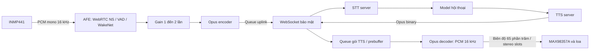

# Báo cáo luồng hoạt động và xử lý

## 1. Kiến trúc

ESP32-S3 xử lý I2S, AFE/WakeNet, Opus và phát loa. Server thực hiện STT → model hội thoại → TTS. Hệ thống hiện hoạt động theo half-duplex.

Khi NS tắt, nhánh uplink của hội thoại dùng PCM mic thô thay cho đầu ra AFE. Audio khi chờ wake word không được gửi server.

## 2. Module và công nghệ

| Module | Trách nhiệm |
|---|---|
| `app_main.c` | Khởi tạo theo stage; điều phối wake word, lượt nghe; gom mẫu, gain, mã hóa và queue uplink |
| `audio_io.c` | Hai I2S độc lập, chuyển mẫu mic 32-bit sang PCM16; nhân đôi PCM mono ra stereo slots; giảm âm lượng và tắt output |
| `voice_afe.c` | Nạp model; feed/fetch AFE độc lập, chuyển kết quả PCM/WakeNet/VAD qua queue |
| `voice_ws.c` | Hello, điều khiển lượt nghe, nhận JSON/binary, queue TTS, giải mã/phát và phục hồi trạng thái kết nối |
| `device_discovery.c` | HTTPS OTA discovery kèm MAC, đọc WebSocket URL/token, thông báo cần ghép đôi |
| `wifi_connect.c` | Kết nối Wi-Fi STA và reconnect; tắt power saving để ưu tiên độ trễ audio |

Firmware dùng ESP-IDF 6.1, FreeRTOS, ESP-SR, micro-opus, esp_websocket_client, esp_http_client, cJSON và mbedTLS/CA bundle. Manifest hiện yêu cầu ESP-SR `~2.5.5`, micro-opus `^0.3.6`, WebSocket client `^1.8.0` và cJSON `^1.7.19`; phiên bản thực tế được cố định bởi `dependencies.lock` của project build.

## 3. Khởi động và xác thực

1. Khởi tạo mic I2S0 và loa I2S1 ở sample rate 16 kHz.
2. Nạp model từ phân vùng `model`; tạo AFE một mic với WakeNet, VAD và tùy chọn WebRTC NS.
3. Tạo encoder Opus và các task xử lý audio trước khi Wi-Fi/TLS sử dụng thêm RAM nội.
4. Kết nối Wi-Fi; gọi `POST /api/device/ota/` với `Device-Id` là MAC Wi-Fi cùng phiên bản ứng dụng.
5. Đọc `websocket.url` và `websocket.token`. Discovery thất bại thì dùng URI/token dự phòng trong menuconfig.
6. WebSocket gửi `Protocol-Version: 1`, `Device-Id` và `Authorization: Bearer` khi token không rỗng. Hello khai báo uplink Opus 16 kHz, mono, 60 ms; chỉ sau hello của server thiết bị mới sẵn sàng.

Nếu discovery trả token `none`, firmware báo cần ghép đôi. Người quản lý cho phép MAC trong trang server rồi khởi động lại board để nhận token. Firmware chưa tự polling discovery để lấy token mới trong cùng lần chạy.

HTTPS discovery và WebSocket dùng CA bundle; mbedTLS dùng allocator PSRAM. Task discovery kết thúc trước khi task khởi tạo WebSocket bắt đầu để giải phóng stack discovery.

## 4. Wake word và uplink

Task `wake_stream` đọc 480 mẫu mỗi khối, tương đương 30 ms ở 16 kHz. Khi chờ, mic được đưa qua AFE để phát hiện “Hi ESP”. Feed gom đúng kích thước do ESP-SR yêu cầu; task fetch riêng nhận thông báo từ feed để xử lý và đưa kết quả vào queue.

WakeNet phát hiện wake word thì firmware gửi `listen/detect` cùng cụm từ cấu hình, sau đó gửi `listen/start` với mode `auto`. Khối mẫu kích hoạt bị bỏ qua và không gửi audio pre-roll lên server.

Khi nghe lệnh:

1. Với NS bật, AFE tiếp tục chạy và PCM đã xử lý được lấy từ đầu ra fetch; với NS tắt, firmware dùng mic thô.
2. Gom 960 mẫu, tương đương 60 ms. Gain được tính từ mức trung bình tuyệt đối, giới hạn 1–2×; frame gần im lặng giữ gain trước đó. PCM được giới hạn trong miền signed 16-bit.
3. Encoder Opus dùng mono 16 kHz, bitrate 24 kbit/s, complexity 1. Task thu không gửi WebSocket trực tiếp mà đưa gói vào queue 8 phần tử.
4. Task `opus_tx` gửi binary khi thiết bị đang nghe và chưa phát TTS. Queue đầy sẽ bỏ gói mới và ghi cảnh báo.
5. Audio im lặng vẫn được gửi; VAD/endpointing trên server quyết định khi nào kết thúc câu, rồi trả STT và tạo câu trả lời.

## 5. Downlink và phát loa

Server công bố TTS Opus mono 24 kHz, 60 ms theo giao thức. Opus decoder trên board được khởi tạo để xuất PCM **16 kHz**; I2S cũng chạy 16 kHz nên tốc độ phát vẫn đúng. Đây là lựa chọn đầu ra decoder, không thay đổi cấu hình TTS hay bitrate của server.

Callback WebSocket ghép đủ binary message, kiểm tra giới hạn kích thước 4096 byte rồi sao chép gói Opus vào queue. Task `tts_playback` là nơi duy nhất giải mã và ghi loa trong Stage Server.

- Queue TTS tối đa 48 gói. Với khung 60 ms, sức chứa tương đương khoảng 2,88 giây audio, không có nghĩa thiết bị luôn chờ từng đó thời gian.
- Trước khi phát hoặc sau khi queue bị hụt, task chờ tối đa 4 gói hoặc 240 ms kể từ gói đầu. TTS stop có thể giải phóng chờ sớm để phát câu trả lời ngắn.
- Decoder reset ở lượt TTS mới và sau lỗi decode; trạng thái decoder nằm trong RAM nội. Scratch pseudostack dùng cấu hình micro-opus hiện có; project đã chọn 240000 byte và tắt tối ưu assembly Xtensa.
- Kiểm tra số mẫu khai báo trước decode, hỗ trợ tối đa 120 ms audio mỗi packet trong buffer PCM. Kiểm tra này không bảo đảm mọi nội dung Opus đều giải mã thành công.
- PCM giảm biên độ còn 65%, nhân đôi vào slot trái/phải của I2S cho MAX98357A.
- DMA TX tự xóa khi thiếu dữ liệu để phát khoảng lặng thay vì lặp mẫu cũ.
- Khi nhận `tts/stop`, task phát hết queue, ghi khoảng lặng xả DMA rồi tắt output I2S. Chỉ khi phát thực sự kết thúc, luồng hội thoại mới mở lượt nghe tiếp theo.

Nếu queue TTS đầy, thiếu RAM hoặc gói decode lỗi, firmware ghi cảnh báo và bỏ gói tương ứng. Bộ đệm giảm jitter nhưng không bảo đảm liên tục khi mạng hoặc server ngừng cung cấp audio quá lâu.

## 6. Trạng thái AFE

| Chức năng | Cấu hình và vai trò |
|---|---|
| Input AFE | Một microphone (`M`), PCM16 mono 16 kHz |
| Kiểu AFE | `AFE_TYPE_SR`, `AFE_MODE_HIGH_PERF` |
| WakeNet | Bật, model mặc định `wn9_hiesp` |
| WebRTC NS | Bật khi `VA_NS_ENABLE=y`; đầu ra xử lý được gửi server trong lượt nghe |
| VAD | Bật; dùng cho phân đoạn ở Stage 2, chưa gate/cắt câu uplink ở Stage Server |
| AEC | Tắt; chưa có kênh tham chiếu phát loa và chưa có barge-in |
| AGC trong AFE | Tắt; gain có giới hạn được xử lý trước Opus ở firmware |
| Nhận dạng lệnh offline | Chưa tích hợp; nhận dạng câu nói do STT server thực hiện |

Trong lúc TTS, firmware tạm dừng đọc mic và fetch AFE. Khi mở lượt nghe kế tiếp, AFE được tiếp tục nếu NS bật. Khi NS tắt, AFE chỉ phục vụ chờ wake word rồi tạm dừng trong hội thoại.

NS là chức năng thử nghiệm cần so sánh thực tế với đường mic thô. Nó có thể giảm tiếng nền nhưng cũng có thể làm suy giảm âm tiết nhỏ. Chất lượng STT còn phụ thuộc vị trí mic, mức tiếng, tiếng ồn và model/VAD của server.

## 7. Task và bộ đệm

| Task | Stack cấu hình, byte | Ưu tiên | Công việc |
|---|---:|---:|---|
| `wake_stream` | 40960 | 4 | Thu mic, AFE feed, gom PCM và mã hóa Opus |
| `afe_fetch` | 16384 | 5 | AFE fetch, WakeNet/VAD/NS và queue kết quả |
| `opus_tx` | 16384 | 5 | Gửi queue Opus uplink qua WebSocket |
| `server_init` | 16384 | 5 | Wi-Fi và HTTPS discovery; tự kết thúc |
| `ws_init` | 6144 | 4 | Khởi động WebSocket và chờ hello; tự kết thúc |
| WebSocket client | 12288 | Do component quản lý | Nhận dữ liệu và dispatch callback |
| `tts_playback` | 8192 | 5 | Prebuffer, decode Opus, ghi I2S và dừng sau khi queue cạn |

Các số trên là kích thước cấu hình, không phải số đo mức dùng tối đa. Các buffer lớn trong luồng thu/phát được giữ ngoài stack task. Queue AFE chứa 4 kết quả; khi đầy, kết quả cũ nhất được thay bằng kết quả mới để hạn chế trễ.

## 8. Phần cứng, chế độ và vận hành

| Thành phần | Kết nối |
|---|---|
| ESP32-S3-N16R8 | Flash 16 MB, PSRAM octal 8 MB |
| INMP441 | BCLK GPIO14, WS GPIO15, DOUT GPIO16; L/R nối GND |
| MAX98357A | BCLK GPIO17, WS GPIO18, DIN GPIO8 |
| Loa 8 Ω / 3 W | Nối SPK+ và SPK− của amplifier |
| Nút bấm / LED | Không sử dụng |

Stage 1 phát tone kiểm tra rồi thu 5 giây và phát lại; Stage 2 dùng WakeNet/VAD với phát lại cục bộ; Stage 3 sử dụng server. Các chế độ được chọn trong menuconfig.

Khi WebSocket ngắt, phiên hội thoại được xóa, các gói TTS cũ bị vô hiệu hóa qua generation và client thử kết nối lại sau 5 giây. Sau hello mới, người dùng cần nói wake word để mở hội thoại lại. Wi-Fi tự thử kết nối lại khi mất liên kết.

Theo dõi các log `WebRTC NS=enabled`, pipeline AFE, `STT`, `Assistant says`, `Opus decode failed`, `TTS Opus queue full`, `Opus TX queue full` và lỗi ghi loa để đánh giá phiên chạy. STT/model/TTS và quyền ghép đôi thuộc server; firmware không tự chọn model hội thoại trên server.
